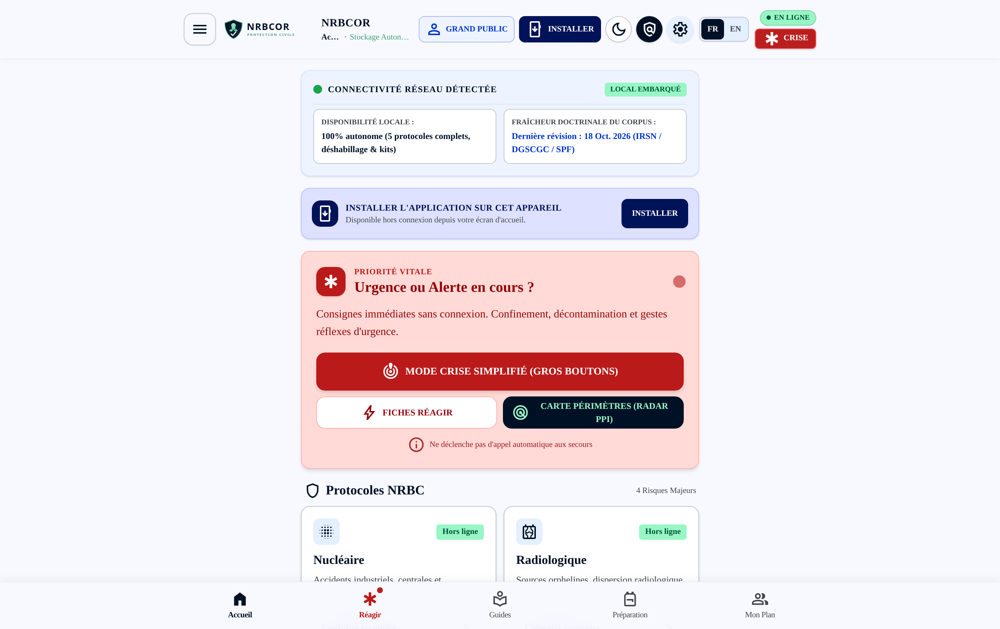
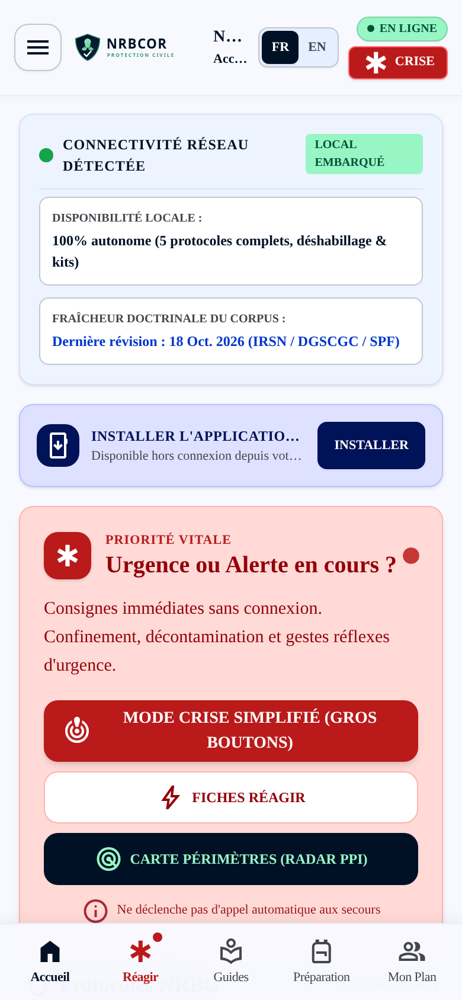
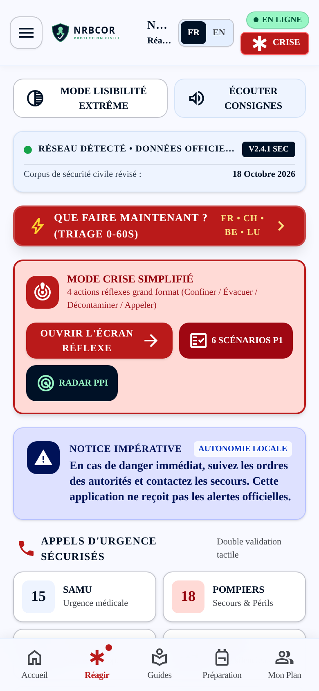
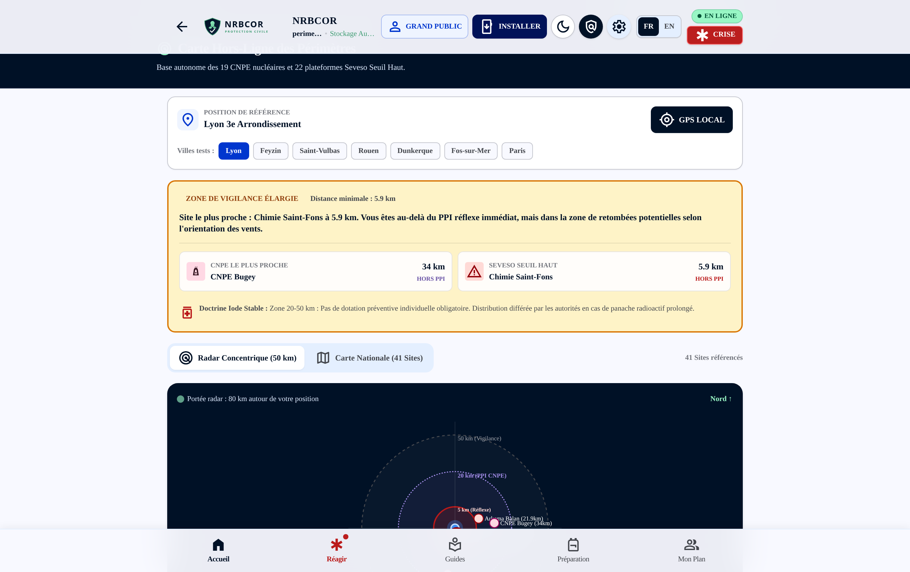
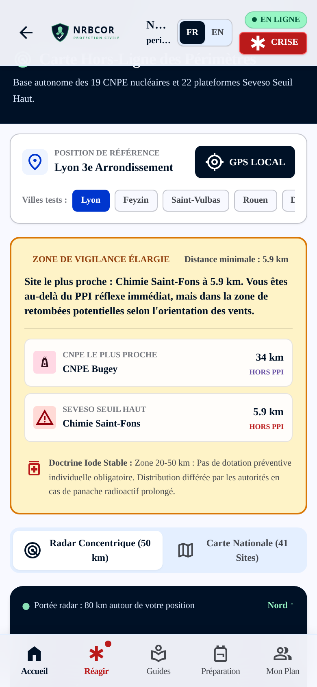
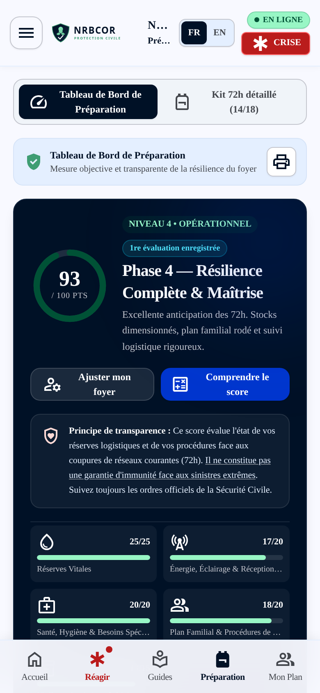
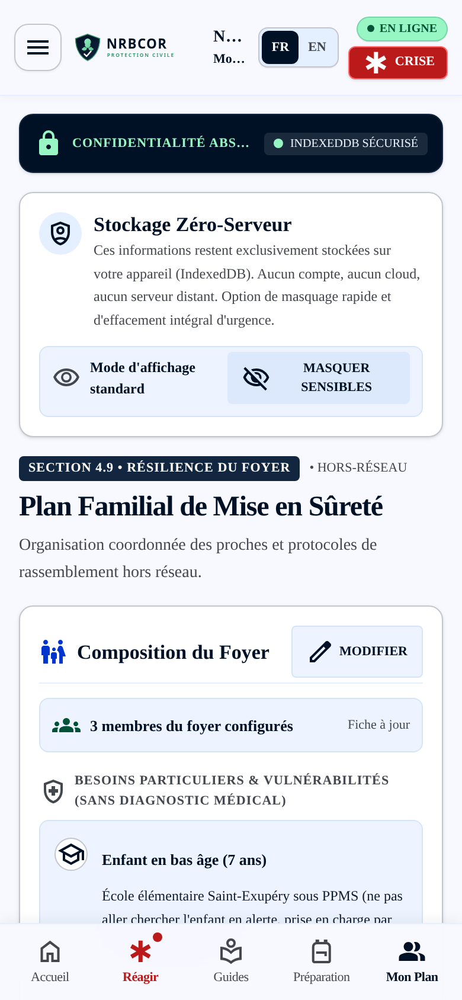
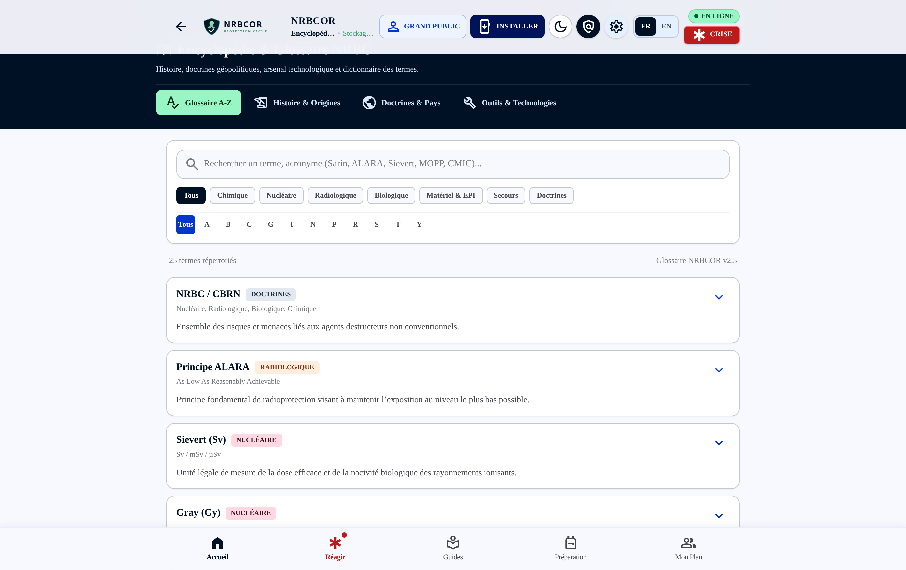

# <p align="center"></p>

<h1 align="center">NRBCOR - Civil Protection & Resilience Against CBRN Risks</h1>

<p align="center">
  <strong>100% Autonomous, Sovereign Offline PWA Application</strong> designed to prepare your household and react with calm and method against major technological, chemical, radiological, biological, and nuclear (CBRN) hazards.
</p>

<p align="center">
  <a href="landing.html"><strong>✨ Discover the NRBCOR Landing Page</strong></a> • 
  <a href="README.md"><strong>🇫🇷 French Documentation (README.md)</strong></a> • 
  <a href="docs/I18N_IMPLEMENTATION_REPORT.md"><strong>🌐 i18n Implementation Report</strong></a> • 
  <a href="docs/LANDING_PAGE_DEPLOYMENT.md"><strong>🚀 Cloudflare & Netlify Deployment Guide</strong></a>
</p>

<p align="center">
  
  
  
  
  
  
</p>

---

## 📋 Quality Assurance & Continuous Integration Commands

```bash
# 1. Strict TypeScript validation
npm run lint

# 2. Automated audit of the civil defense corpus (URLs, metadata, FR/CH/BE/LU/IAEA doctrines)
npm run check:content

# 3. Complete automated test suite (readiness calculations + i18n parity: 273 tests)
npm test

# 4. Dedicated internationalization (i18n) verification
npm run test:i18n

# 5. Production PWA build
npm run build
```

Additional documentation:
- 🌐 [Complete Internationalization Implementation Report](docs/I18N_IMPLEMENTATION_REPORT.md)
- 📜 [Doctrinal Corpus & Regulatory Traceability](docs/CORPUS_NRBC.md)
- 🧪 [Acceptance Protocol & Quality Checklist](docs/TESTING_CHECKLIST.md)
- 📦 [Changelog & Version History](CHANGELOG.md)

---

## 📸 Authentic Application Screenshots

The **NRBCOR** user interface is engineered for instantaneous field clarity, high-contrast legibility under extreme stress, and seamless responsiveness across desktop monitors and mobile touchscreens.

### 🖥️ 1. Main Dashboard & Home Screen (Desktop View)
> *Header bar with Citizen / Expert mode toggle, PWA install button, local network status detector, doctrinal corpus verification, and 1-tap priority crisis protocols.*

<p align="center">
  
</p>

---

### 📱 2. Mobile Smartphone Experience: Home & Emergency Reflex Mode
> *Built for single-handed operation in the dark or under duress: live network sensing, high-visibility CRISIS trigger, 0-60s reflex triage, and synthesized voice guidance.*

<p align="center">
  
  
</p>

---

### 🗺️ 3. Concentric PPI Radar & Offline Map of 19 Nuclear Plants & Seveso Sites
> *100% offline geodesic proximity engine. 80 km concentric radar detailing immediate reflex radii (5 km), nuclear PPI zones (20 km), and extended vigilance perimeters (50 km).*

<p align="center">
  
</p>

<p align="center">
  
</p>

---

### 🎒 4. Household Logistics (72h Survival Kit) & Family Safety Plan
> *Left: explainable 100-point resilience scoring, breakdown of water reserves (3L/day/person) and calories. Right: Family Safety Plan (PFMS), emergency contacts, and zero-server local storage in IndexedDB.*

<p align="center">
  
  
</p>

---

### 📚 5. Documented CBRN Encyclopedia & Doctrinal Glossary A-Z
> *25 in-depth technical definitions (ALARA, Sievert, Gray, MOPP, CMIC, ABEK2P3, etc.), historical lineage from 1914, and comparative analysis of global civil defense doctrines (France, Switzerland, Belgium, USA, Russia, Israel).*

<p align="center">
  
</p>

---

## 🌟 Major Highlights (Version 1.6.0)

### 🌐 1. Full Bilingual Internationalization (French & English)
* **Instant, Persistent Language Switcher**: Switch seamlessly between French (default) and English in the header bar, hamburger drawer, and settings.
* **100% Offline-First Bundling**: Zero reliance on remote translation APIs or external network calls; all strings and CBRN datasets are embedded directly in the PWA service worker cache.
* **Exact Doctrinal Equivalence**: 248 translation keys per language with 100% parity verified via automated test scripts (`npm run test:i18n`).
* **Cross-Border Preservation**: Maintains jurisdiction-specific doctrines (France's 20km PPI and FR-Alert, Switzerland's Alertswiss and 50km siren radius, Belgium's BE-Alert, Luxembourg's LU-Alert) with emergency dispatch lines preserved without false anglicization.
* **Accessible Speech Synthesis**: Localized text-to-speech for stress-mode emergency guidance (`fr-FR` or `en-US` depending on language choice).

### 📚 2. CBRN Risk Mini-Encyclopedia & Illustrated History
* **Historical Origins**: Four decisive eras detailed (1914–1925 birth at Ypres with Fritz Haber, WWII organophosphates & atomic dawn, Cold War VX & Chernobyl, modern era Tokyo sarin, Fukushima, and Novichok).
* **Comparative Military Doctrines**: Comparative analysis of national civil protection paradigms:
  * France (SGDSN interministerial continuum, CMIR / CMIC rescue units).
  * Switzerland (370,000 shelters ensuring 100% bunker coverage for citizens).
  * United States & NATO (MOPP gear standards, BARDA, USAMRIID).
  * Russia (Autonomous Radiological, Chemical and Biological Defense Troops - RKhBZ).
  * Israel (Compulsory reinforced Mamad blast rooms in every home).
* **Technological Defense Arsenal**:
  * *Detection*: Geiger-Müller counters, Ion Mobility Spectrometry (IMS), Dräger tubes, mobile field PCR.
  * *Protection (PPE & Shelters)*: ABEK2P3 combined canister panoramic respirators, Type 1 gas-tight hazmat suits, overpressure HEPA-charcoal filtered bunkers.
  * *Decontamination*: Step-by-step 8-stage undressing (removes 80-90% of toxic load), Fuller's earth, active chlorine/amphoteric solutions.
  * *Antidotes*: Atropine / Pralidoxime auto-injectors, Potassium Iodide (KI 65mg) tablets, Prussian Blue / Ca-DTPA decorporation agents.

### 📖 3. Terminology & Acronym Glossary A–Z
* Over 20 comprehensive entries with short definition, exhaustive technical breakdown, tactical operational context, historical background, and cross-references.
* Instant client-side search engine, thematic tags (Nuclear, Chemical, Biological, Radiological, Logistics, Regulation), and alphabetical selector.

### 🚨 4. Coherence Matrix & 6 Critical Emergency Scenarios
* Strict validation preventing false impressions of safety:
  * Official shelter-in-place instructions.
  * Mandatory evacuation order.
  * Unidentified CBRN incident (universal reflexes without diagnosis delay).
  * Complete network blackout (resilient analog FM broadcast fallback).
  * Outdated or unvalidated municipal cards.
  * Contradiction between general advice and recent official orders (authorities ALWAYS prevail).
* "What to do right now?" 1-Tap 0–60s triage modal with direct calling buttons for France, Switzerland, Belgium, and Luxembourg.

### 📊 5. Transparent Readiness Dashboard & Autonomous Storage
* Mathematical breakdown of water needs (3L/person/day + 0.5L/pet) and unheated food calories (2,000 kcal/adult/day).
* Transparent calculation hypotheses, missing data remediation list, and Top 3 highest-yield next actions.
* Two-tier local sovereign persistence:
  * **Tier 1 (Authority)**: IndexedDB asynchronous storage for 72h Kit, Family Plan, Inventory, and Local Georisques snapshots.
  * **Tier 2 (Fast Boot)**: Synchronous local mirror for instant theme and accessibility boot without display flickering.

---

## 🛠️ Tech Stack & Architecture

- **Frontend Core**: React 19, TypeScript strict mode, Vite 8
- **Styling**: Tailwind CSS v4, Google Fonts (Space Grotesk & Inter), Material Symbols
- **Persistence**: IndexedDB (Primary) + LocalStorage (Mirror), Zero Cloud Transit
- **Localization**: Pure lightweight typed React Context (`src/i18n/`) with `Intl` native formatters
- **PWA & Offline**: Web App Manifest, Service Worker caching, 100% offline autonomy

---

## ⚖️ Legal Notice & Civil Defense Boundaries

NRBCOR is an independent civic preparation and education tool.
- It does **NOT** receive automated government push broadcasts (FR-Alert / Alertswiss / BE-Alert).
- It never replaces designated emergency services (112, 18, 15, 144, 100, 114).
- In real-world emergencies, **official instructions broadcast by prefectural and civil defense authorities over national emergency radio and sirens supersede all pedagogical guidelines**.

---

<p align="center">
  <strong>NRBCOR Project</strong> • Sovereign Civil Resilience • Open Knowledge
</p>
