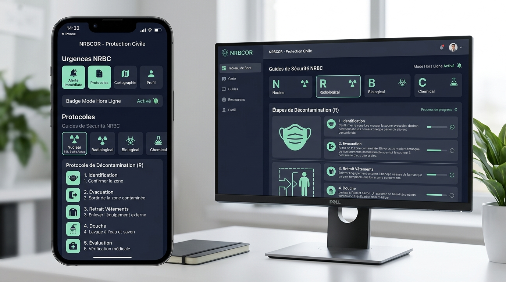

# <p align="center"></p>

<h1 align="center">NRBCOR - Protection Civile & Résilience Face aux Risques NRBC</h1>

<p align="center">
  <strong>Application PWA citoyenne 100% autonome et hors-ligne</strong> conçue pour préparer votre foyer et réagir avec calme et méthode face aux risques technologiques majeurs, chimiques, radiologiques, biologiques et nucléaires.
</p>

<p align="center">
  
  
  
  
  
</p>

---

## 📸 Aperçu & Capture d'Écran de l'Application

<p align="center">
  
</p>

> *Aperçu de l'interface NRBCOR : mode réagir sous stress, fiches doctrinales NRBC, checklist dynamique du kit d'urgence 72h et surveillance des mises à jour en arrière-plan.*

---

## 🌟 Nouvelles Fonctionnalités Majeures (Mise à Jour v1.2.0)

### 🍔 1. Menu Hamburger avec Organisation Thématique
* **Regroupement fonctionnel par catégories d'urgence** :
  * 🚨 **1. Urgence & Réflexes Immédiats** : Mode Réagir, Déshabillage & Décontamination (8 étapes), Guide Confinement Étanche, Signaux d'Alerte RNA.
  * 🛡️ **2. Fiches & Risques NRBC** : Catalogue complet, Nucléaire, Chimique, Biologique, Fiche Iode Stable (KI 65mg).
  * 📦 **3. Résilience & Préparation** : Kit 72h, Inventaire & Péremptions, Plan Familial, Risques Locaux (Géorisques).
  * 🎓 **4. Formation & Exercices** : Simulations d'immersion, Exercices chronométrés, Quiz de validation.
  * ⚙️ **5. Paramètres Système & Données** : Mises à jour, Échelle de texte WCAG, Sauvegarde/Restauration JSON, Mentions Légales.

---

### ⚙️ 2. Paramètres Système & Mises à Jour Automatiques en Arrière-Plan
* **Date de sortie officielle** : Horodatage certifié du cycle doctrinal (`13 Octobre 2026 - v1.2.0 PWA`).
* **Date de la dernière vérification** : Horodatage dynamique mémorisé en local lors de chaque audit réseau.
* **Bouton « Vérifier les mises à jour »** : Déclenche une inspection en direct auprès du Service Worker et rafraîchit le cache sans recharger la page.
* **Bouton « Forcer la mise à jour »** : Purge les anciens caches Workbox et recharge la version la plus récente de l'application.
* **Système d'auto-actualisation silencieuse en tâche de fond** : Le Service Worker interroge périodiquement (toutes les 15 minutes) le serveur pour récupérer d'éventuels correctifs sans interrompre l'utilisateur.

---

### ☀️ 3. Thème Clair & Sombre avec Basculement Immédiat
* **Thème Clair (Mode Jour)** : Palette lumineuse contrastée optimisée pour une consultation en plein soleil ou en déplacement extérieur.
* **Thème Sombre (Mode Nuit & Confinement)** : Interface feutrée préservant l'autonomie de la batterie et réduisant l'éblouissement en pièce calfeutrée sans éclairage.
* **Thème Système Automatique** : S'adapte en temps réel aux réglages d'affichage de votre smartphone ou de votre ordinateur.
* **Accès rapide** : Bouton d'inversion directe (☀️ / 🌙) dans l'en-tête, le menu hamburger et les paramètres.

---

### ⚖️ 4. Onboarding & Décharge Formelle de Responsabilité
* **Clause juridique explicite de non-responsabilité** : Mention obligatoire spécifiant que l'éditeur et l'auteur déclinent formellement toute responsabilité quant aux données, calculs et protocoles fournis dans l'application.
* **Rappel des prérogatives régaliennes** : Rappel que l'application est un outil civique et éducatif qui **ne se substitue en aucun cas aux décisions et ordres d'évacuation des autorités publiques compétentes** (Préfet, Sécurité Civile, SAMU 15, Pompiers 18, FDO 17).
* **Validation contractuelle** : Case à cocher obligatoire pour débloquer le premier usage, avec possibilité de revoir la clause à tout moment depuis le menu ou les paramètres.

---

### 💡 5. Onboarding Contextuel & Infobulles d'Aide (Tooltips)
* **Infobulles interactives discrètes (💡)** réparties sur les points clés :
  * Explication de la norme de 3L d'eau par jour et par personne.
  * Rappel absolu de ne **jamais prendre d'iode stable sans ordre explicite du Préfet**.
  * Intérêt stratégique du contact relais familial hors-zone (+50 km).
  * Principe du calcul d'autonomie d'oxygène en pièce hermétiquement close.
  * Consignes de libération des réseaux mobiles (SMS courts, pas d'appels superflus).

---

### 📲 6. Bouton « Installer l'application » (PWA Install)
* **Bouton dédié visible dans le header, le menu hamburger et l'accueil** :
  * Sur **Android / Chrome / Edge** : Déclenche l'invite native d'installation en 1 clic.
  * Sur **iPhone / iPad (Safari)** : Ouvre un guide pas-à-pas illustré (*« Bouton Partager ⎋ > Sur l'écran d'accueil ⊕ »*).
  * Sur **Ordinateur (Desktop)** : Guide l'utilisateur vers l'icône d'installation dans la barre d'adresse.
  * Idéal pour les utilisateurs novices voulant retrouver l'application directement parmi leurs icônes de smartphone.

### 🛡️ 7. Priorité 1 — Fiabilisation des Consignes de Sécurité & Non-Substitution Opérationnelle
* **Confinement contextualisé par scénario précis** :
  * *Accident Chimique* : Confinement impératif à l'étage intermédiaire (1er/2e) ; interdiction absolue des caves et sous-sols où s'accumulent les gaz denses (chlore, GPL, dioxyde de soufre) et des combles (gaz légers comme l'ammoniac). Si pris dehors : fuite impérative à 90° de la direction du vent (jamais en voiture).
  * *Accident Nucléaire / Radiologique* : Le sous-sol ou la pièce centrale en dur offre l'écran radiologique le plus dense contre les rayonnements gamma (atténuation 10 à 20x supérieure à un étage sous toiture).
  * *Accident Biologique* : Pièce isolée avec point d'eau, masque FFP3 ajusté, arrêt immédiat des VMC non filtrées.
* **Simulateur d'air disponible fiabilisé** :
  * Calcul basé sur la cinétique d'accumulation du CO2 (< 1% seuil de vigilance) et la consommation respiratoire au repos.
  * Encadré d'avertissement formel : **modèle mathématique indicatif non opérationnel**. Rappel que le confinement civil d'urgence dure généralement **2 à 4 heures** (temps de dispersion du panache) et qu'une simulation ne doit JAMAIS inciter à différer l'ordre d'aération ou d'évacuation préfectorale.
* **Fiche Iode Stable (KI 65mg) rigoureusement conforme ASN / IRSN** :
  * **Ordre préfectoral formel obligatoire** : Aucune ingestion préventive sauvage.
  * **Fenêtre temporelle d'efficacité** : Optimale 1 à 2h avant le panache (~100%), résiduelle jusqu'à 6h, inutile et déconseillée après 24h.
  * **Contre-indications médicales officielles** : Allergie avérée, maladies thyroïdiennes actives graves, maladies cutanées auto-immunes (dermatite herpétiforme).
  * **Avertissement contre les faux remèdes mortels** : Interdiction formelle de boire de la Bétadine (corrosif digestif létal) ou de surconsommer du sel de cuisine (hypernatrémie mortelle).
* **Risques Chimiques fiabilisés** :
  * Rappel capital : **les masques FFP2 / FFP3 ne protègent PAS contre les gaz et vapeurs chimiques** (chlore, ammoniac, CO).
  * Le linge humide n'est qu'un **moyen de fortune d'ultime recours** (filtration partielle pendant 2-3 min des seuls gaz hydrosolubles).
  * Interdiction absolue de prendre de l'iode pour un risque chimique.

---

### 🗺️ 8. Audit de Fonctionnement & Transparence Géorisques
* **🟢 Fonctions Réellement Opérationnelles** :
  * **Géolocalisation GPS W3C Réelle** : Récupération des coordonnées physiques matérielles du terminal (latitude, longitude, précision). Géocodage inverse officiel automatique via l'API `geo.api.gouv.fr` ou projection géodésique hors-ligne (Haversine) sur les bassins de référence sans aucun transit serveur.
  * **Recherche de Communes en Direct** : Recherche instantanée parmi les 35 000 communes françaises via l'API publique nationale.
  * **Export d'un Instantané Territorial Réel** : Génération et téléchargement effectif d'un fichier normé `instantane-georisques-[commune]-[date].json` sur votre terminal avec traçabilité explicite du niveau de fiabilité (`OFFICIEL_DIRECT_API`, `OFFICIEL_CACHE_LOCAL`, `OFFICIEL_DIRECT_API_AUCUN_RISQUE_RECENSE` ou `ECHANTILLON_PEDAGOGIQUE`).
  * **Synthèses Communales & Cadre Réflexe** : Consultation hors-ligne des synthèses d'information préventive (DICRIM, PCS), fiches réflexes et contact officiel de la Mairie via l'Annuaire du Service Public (DILA). Les textes intégraux paraphés par les Maires restent opposables auprès des mairies respectives.
* **🟡 Démonstration & Schéma Pédagogique** :
  * **Carte Vectorielle Schématique** : Modélisation didactique légère des périmètres PPI, couloirs TMD et CNPE en SVG natif (maquette d'entraînement sans prétention de Système d'Information Géographique officiel).
* **🔵 Fonctionnalités Indisponibles Hors-Connexion** :
  * **Actualisation en direct de l'API Géorisques** (`georisques.gouv.fr / GASPAR`) et **liens sortants** vers les portails officiels de l'État : nécessitent une connexion Internet active et basculent automatiquement sur le cache local vérifié en cas d'absence de réseau.

---

### 💾 9. Priorité 4 — Unification de la Persistance Locale & Stratégie Double-Niveau
* **Architecture à Double Niveau (IndexedDB Prioritaire + Cache Miroir)** :
  * **IndexedDB (Autorité Principale)** : Moteur asynchrone robuste sans contrainte de quota (magasins dédiés : `settings`, `checklistItems`, `familyPlans`, `inventoryItems`, `localRiskSnapshots`, `quizProgress`). Tous les éléments du kit 72h, le plan familial complet, l'inventaire des vivres et les données de profil y sont conservés durablement.
  * **Miroir Local Synchrone (`localStorage`)** : Cache d'amorçage immédiat pour le thème clair/sombre et les éléments critiques évitant tout flash ou sursaut au rechargement de page.
* **Sauvegarde & Restauration Intégrale V2 (`NRBCOR_BACKUP_V2`)** :
  * Fichier d'archive JSON scellé contenant l'intégralité des données (Kit personnalisé, Plan familial, Membres, Contacts, Inventaire des stocks, Préférences).
  * Validation stricte du schéma avec rétrocompatibilité V1.
* **Purge Sécurisée Totale (Wipe)** :
  * Réinitialisation atomique de l'ensemble des magasins IndexedDB et des clés de cache local sans laisser de résidu.
* **Tableau de Bord & Santé du Stockage** :
  * Diagnostic en direct dans l'écran Paramètres avec monitoring des magasins, estimation de l'espace alloué (`navigator.storage.estimate`) et bouton de vérification d'intégrité.

---

### 📊 10. Priorité 5 — Tableau de bord « Suis-je prêt ? » (Parcours Concret & Mesurable)
* **Score de Préparation Transparent (100 Pts)** :
  * Repose sur **5 piliers audités sans boîte noire** :
    1. *Réserves Vitales (Eau & Alimentation)* — 25 pts (3L/jour/pers + 0,5L/jour/animal, rations sans cuisson, purification).
    2. *Énergie, Éclairage & Communication* — 20 pts (Radio FM/DAB+ indépendante, torches LED, Powerbanks, piles de rechange).
    3. *Santé, Hygiène & Besoins Spécifiques* — 20 pts (Trousse normée, couverture médicale/ordonnances, adaptation PMR/nourrisson).
    4. *Plan Familial & Procédures de Repli* — 20 pts (Contact relais hors-zone > 100 km, point de ralliement, vannes d'arrêt).
    5. *Vigilance Logistique & Maintenance* — 15 pts (Contrôle semestriel, 0 produit périmé, kit calfeutrage hermétique).
  * **Avertissement déontologique rigoureux** : Le score mesure un niveau d'anticipation matérielle selon les guides de la Sécurité Civile mais n'offre aucune garantie d'immunité face aux aléas exceptionnels. Les ordres diffusés par les autorités restent toujours prioritaires.
* **Personnalisation & Besoins Spécifiques** :
  * Prise en compte dynamique de la composition réelle du foyer : adultes, enfants (4-12 ans, PPMS école), nourrissons (lait infantile, couches, sérum physiologique), personnes âgées et animaux de compagnie.
  * Prise en compte explicite des vulnérabilités : personnes à mobilité réduite (PMR), affections de longue durée (stock 15-30j ordonnances), et voisinage d'installations Seveso ou centrales nucléaires (périmètre PPI).
* **Jauges d'Autonomie en Coupure Totale** :
  * *Eau potable* : Heures et jours réels calculés selon les personnes et animaux (+ bouton rapide d'ajout de packs de 9L).
  * *Alimentation de survie* : Rations consommables froides sans cuisson ni électricité.
  * *Éclairage* : Heures d'éclairage LED disponibles avec les piles en réserve.
  * *Énergie & Info* : Recharges smartphone possibles et radio manivelle d'alerte.
* **Éléments Manquants & Actions de Progrès** :
  * Liste triée par criticité (Vital, Sécurité, Logistique) avec bouton d'acquisition en 1 clic mettant à jour IndexedDB et le score en direct.
  * Suivi des échéances de péremption avec alertes à 60 jours et validation de l'audit semestriel ce jour.
  * Actions recommandées hiérarchisées avec estimation du gain de points (+3 à +8 pts).

---

## 🏛️ Corpus Doctrinal et Risques Couverts

| Code | Risque | Scénarios Clés | Actions Réflexes Principales |
|---|---|---|---|
| **N** | **Nucléaire** | Accident de réacteur civil, rejet de radionucléides atmosphériques | Confinement en dur, murs épais, attente de l'ordre préfectoral pour l'iode stable (KI). |
| **R** | **Radiologique** | Source orpheline perdue, dispersion radiologique (bombe sale) | Éloignement immédiat, interposition d'écrans denses (plomb, béton, terre), lavage sans friction. |
| **B** | **Biologique** | Épidémie émergente, dissémination aéroportée d'agents pathogènes | Masque FFP3, barrière cutanée, hygiène stricte, isolement des flux d'air. |
| **C** | **Chimique** | Fuite d'usine Seveso, déraillement TMD, gaz toxiques ou neurotoxiques | Fuite transversale au vent, calfeutrage des aérations, arrêt immédiat de la VMC. |

---

## 🧰 Fiches et Procédures Incluses

* 🧴 **Déshabillage & Décontamination Pas-à-Pas (8 étapes)** : Délimitation de sas souillé, découpe des vêtements sans secouer, double ensachage hermétique étanche, rinçage cutané doux à l'eau claire.
* 💊 **Calculateur d'Iodure de Potassium (KI 65mg)** : Posologie certifiée selon l'âge (nouveau-né, nourrisson, enfant, adulte, femme enceinte).
* 🚪 **Guide Confinement Étanche & Simulateur Didactique d'Air** : Modèle volumétrique indicatif de renouvellement d'air en pièce calfeutrée avec avertissement formel interdisant d'interpréter ce calcul comme une garantie de survie.
* 📢 **Simulateur Sonore du Signal National d'Alerte (RNA)** : Synthétiseur Web Audio API reproduisant le cycle réglementaire (1 min 41 s x 3) et le signal de fin d'alerte (30 s continu).
* 📋 **Checklist Paramétrique du Kit 72h** : Rations, lampes dynamo, radio FM, pharmacie d'urgence et inventaire avec alerte de péremption.
* 🧭 **Mon Plan Familial de Mise en Sûreté** : Points de ralliement, mode discret pour masquer les données à l'écran, et bouton de purge complète sécurisée.
* 🗺️ **Module Géorisques & Analyse Territoriale** : Consultation des arrêtés préfectoraux GASPAR en direct ou mis en cache local, échantillon didactique d'entraînement distinct, coordonnées officielles de la Mairie et schéma vectoriel d'incidence.

---

## 💻 Installation et Commandes de Développement

```bash
# 1. Cloner le dépôt
git clone https://github.com/votre-compte/nrbcor.git
cd nrbcor

# 2. Installer les dépendances
npm install

# 3. Lancer l'environnement de développement local (Port 3000)
npm run dev

# 4. Vérifier les types TypeScript
npm run lint

# 5. Exécuter la suite complète de 133 tests fonctionnels & réglementaires
npm test

# 6. Contrôler la conformité éditoriale et la traçabilité doctrinale
npm run check:content

# 7. Compiler l'application pour la production
npm run build
```

---

## 🛡️ Respect de la Vie Privée & Zéro Télémétrie

1. **Aucun cookie de pistage**, aucun identifiant publicitaire, aucune analyse tierce.
2. **Stockage strictement confiné** dans l'espace `IndexedDB` local de votre navigateur (`nrbc-preparation-db`).
3. **Export et Import JSON** sous votre contrôle exclusif pour migrer vos données d'un appareil à l'autre sans jamais transiter par un serveur.

---

## 📜 Mentions Légales & Avertissement

L'éditeur et l'auteur de l'application **NRBCOR** déclinent toute responsabilité quant à l'exactitude, l'exhaustivité, la mise à jour ou l'usage des données, informations, simulateurs et protocoles fournis dans l'application. Cette application est un outil d'information civique et éducatif. En situation de crise réelle ou d'accident technologique, **seules les consignes formelles des autorités publiques (Préfet de département, Ministère de l'Intérieur, Sécurité Civile, SAMU 15, Pompiers 18, Police/Gendarmerie 17) sont valables et opposables.**
